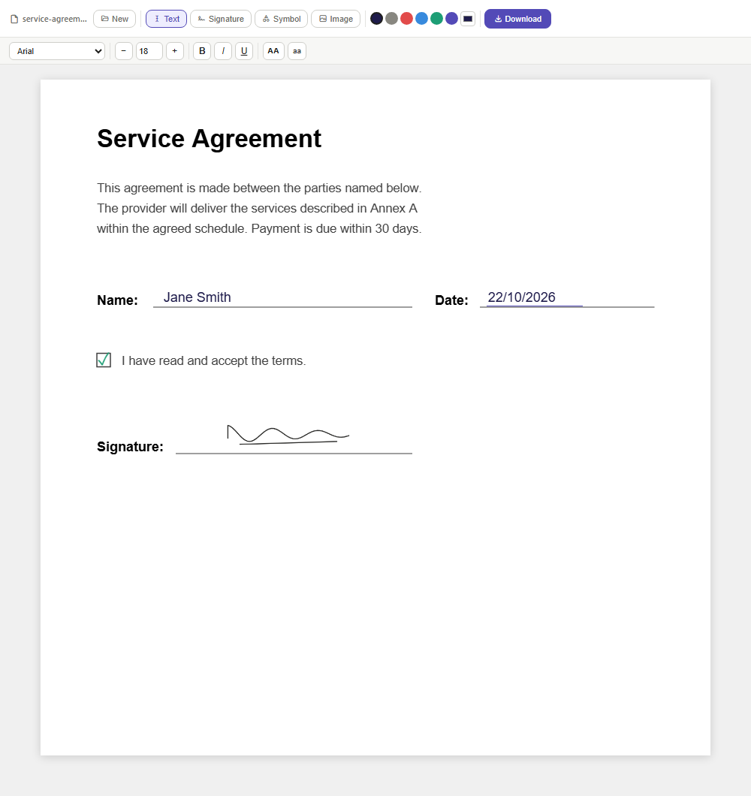

# Editor PDF (italiano)

Editor PDF in una sola pagina che funziona interamente nel browser: aggiungi **testo, simboli, immagini e una
firma disegnata a mano** a qualsiasi PDF, poi scarica il file modificato. Niente viene caricato online.

🇬🇧 **English version:** [../README.md](../README.md)

**Usalo online:** <https://fabiofctrl.github.io/pdf-editor/it/>
(oppure <https://fabiofctrl.github.io/pdf-editor/?lang=it>)

## Funzioni

- **Testo**: clicca in un punto della pagina e scrivi. Carattere (Arial, Helvetica, Times New Roman, Courier New,
  Georgia, Verdana, Trebuchet MS), dimensione, grassetto, corsivo, sottolineato, MAIUSCOLO/minuscolo, colore.
- **Firma**: disegnala con il mouse o con il dito, poi clicca dove posizionarla.
- **Simboli**: ✓ ✗ ○ ● □ ■ ◆ △ → ★ e altri, nel colore selezionato.
- **Immagini**: inserisci qualsiasi immagine (PNG, JPG, …).
- Ogni elemento si può **spostare**, **ridimensionare**, **ruotare** ed **eliminare** (passa sopra con il mouse per
  vedere le maniglie).
- **Scarica** salva un nuovo PDF chiamato `<originale>_modificato.pdf`.
- Interfaccia in inglese e italiano: inglese all'indirizzo principale, italiano su `/it/` o con `?lang=it`.

## Privacy

Il PDF viene letto e scritto da JavaScript dentro la scheda del browser. Non viene mai inviato a un server; GitHub
Pages serve solo la pagina. Le librerie vengono caricate da CDN pubblici (vedi sotto), quindi serve una connessione
a internet per aprire la pagina.

## Usarlo in locale

Scarica `index.html` e aprilo nel browser (Chrome, Edge, Firefox). Non serve installare nulla; la connessione serve
solo per scaricare le librerie all'apertura.

## Librerie

| Libreria | Versione | Uso | Licenza |
|---|---|---|---|
| [PDF.js](https://mozilla.github.io/pdf.js/) | 3.11.174 | visualizzazione delle pagine | Apache-2.0 |
| [pdf-lib](https://pdf-lib.js.org/) | 1.17.1 | scrittura del PDF modificato | MIT |
| [Tabler Icons](https://tabler.io/icons) | 2.47.0 (webfont) | icone della barra | MIT |

## Limiti noti

- Il testo viene scritto con i 14 caratteri standard del PDF, che coprono solo i caratteri dell'Europa occidentale
  (Windows-1252, quindi lettere accentate italiane comprese). Caratteri fuori da questo insieme (emoji, greco,
  cirillico, ✓ scritto come testo) non si possono salvare come testo: per segni come ✓ usa lo strumento **Simbolo**.
- I caratteri diversi da Times/Georgia e Courier vengono salvati come Helvetica; il sottolineato si vede durante la
  modifica ma non viene scritto nel PDF.
- Gli elementi aggiunti vengono disegnati sopra la pagina: il testo già presente nel PDF non si può modificare né
  cancellare.
- Per disegnare la firma vanno bene mouse e dito; per spostare e ridimensionare serve il mouse.

## Licenza

MIT — vedi [LICENSE](../LICENSE).
